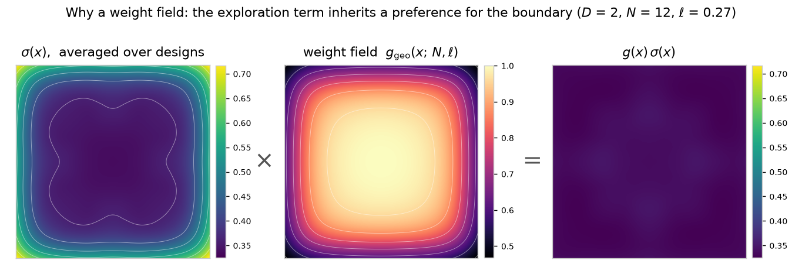
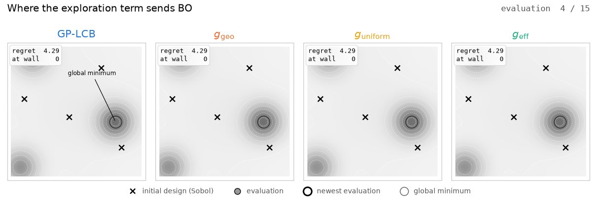

# Understanding Hidden Spatial Preferences in Bayesian Optimization

Code and weight fields for the paper (under review).

On a bounded domain the GP posterior variance is larger near faces, edges and
corners, so any variance-based acquisition function prefers the boundary. We
replace that implicit preference with an explicit one: a weight field
`g(x; N, ell)` on the exploration term of GP-LCB,

    alpha(x) = mu(x) - lambda * g(x) / mean(g) * sigma(x)



Averaged over random designs, `sigma` is about twice as large in the corners
as in the interior (left). `g_geo` has the inverse shape (middle), and the
weighted term is flat (right). D = 2, N = 12 observations.



The same initial design and seed, four rules, on the synthetic landscape of
the paper. Plain GP-LCB spends its evaluations along the walls and ends in a
local basin; the weighted rules reach the interior optimum.

| field | principle |
|---|---|
| `geo` | geometric equalization: the expected exploration term is constant over the domain |
| `uniform` | uniform allocation: the next pure-exploration pick is approximately uniform over the domain |
| `eff` | efficiency-oriented exploration: favors uncertainty that reduces more uncertainty elsewhere |

The fields are small neural networks, one per principle and dimension
(D = 2 to 6), evaluated at the current number of observations and the
exploration lengthscale, and differentiable in `x`.

## Install

    pip install -e .              # numpy, scipy, torch
    pip install -e ".[tutorial]"  # + matplotlib, jupyter

## Usage

```python
import torch
from spatialbo import load_field, reference_lengthscale

D = 2
g = load_field("geo", D)            # or "eff", "uniform"
ell = reference_lengthscale(D)      # exploration lengthscale used in the paper
X = torch.rand(100, D, dtype=torch.float64)
w = g(X, N=10, ell=ell)             # weights at X after 10 observations
```

The test functions are included:

```python
from spatialbo import FUNCS, standardized
f, D = FUNCS["mb4_2d_interior"]     # synthetic landscape; also the benchmark functions
h, D = standardized("hartmann_3d")  # maximized and standardized, as in the experiments
```

`tutorial/tutorial.ipynb` walks through the test functions, the three fields,
a weighted GP-LCB loop with the package's surrogate and optimizer, and how to
use a field inside your own optimizer.

## Layout

    spatialbo/    GP, equalizer, weight fields, weighted GP-LCB and its optimizer, test functions
    fields/       the trained fields, one file per field and dimension (see fields/FIELDS.md)
    experiments/  BO runner, launch scripts and scoring (see experiments/README.md)
    training/     reference designs, field training, g_uniform calibration and certification
    plots/        figure scripts; the two figures above are made by plots/make_readme_*.py
    results/      scored summaries used by the figure scripts
    tutorial/     notebook

## Citation

A BibTeX entry will be added once the preprint is on arXiv.

## License

Apache 2.0.
